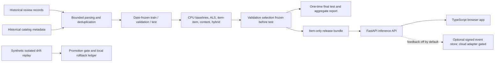

# Architecture

All raw and user-level data stay local. The serving bundle contains item-side data only. Historical metadata is not guaranteed to be time-aligned. The Dockerized FastAPI service and TypeScript app are deployed together on one Render Free service; Azure templates remain an unused alternative. See the [POC walkthrough](docs/WALKTHROUGH.md) and [release record](deploy/render/release.json). Feedback is disabled; drift and promotion exercises are local synthetic demonstrations.
