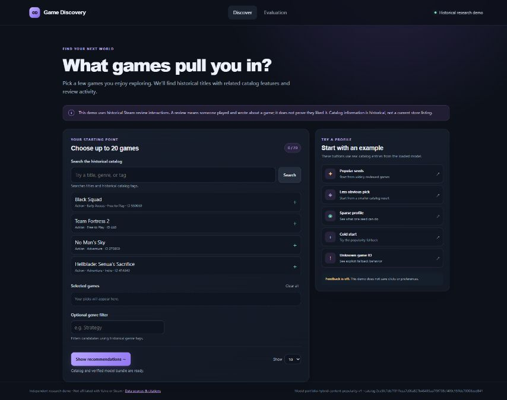
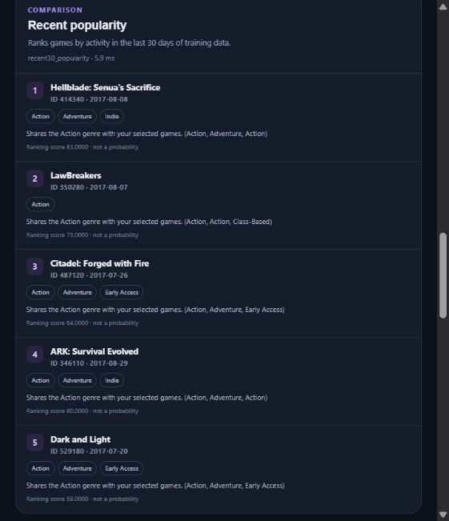
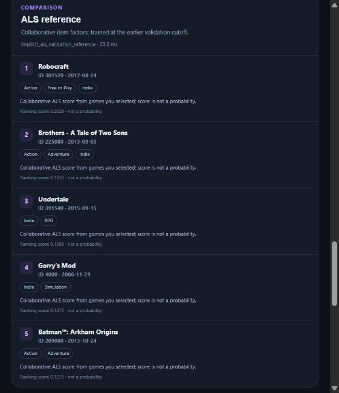
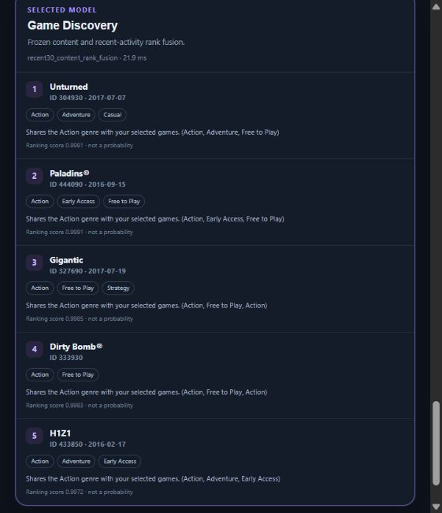
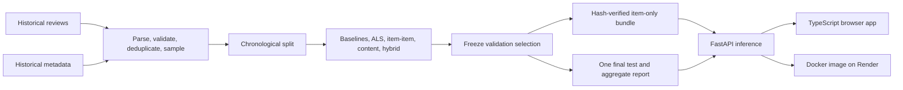

# Game Discovery

### Historical game recommendation — evaluated offline, served online

Pick a few games, compare three ranking approaches, and inspect why each title appears. This project connects a reproducible recommendation experiment to a FastAPI service and TypeScript interface using historical Steam review interactions and catalog metadata.

**[Live demo](https://game-discovery-ml.onrender.com)** · **[POC walkthrough](docs/WALKTHROUGH.md)** · **[Interactive API](https://game-discovery-ml.onrender.com/docs)** · **[Evaluation](EVALUATION.md)**

Render Free can sleep after inactivity; the first request may take about a minute to wake the service.



## What this project demonstrates

| Capability | Implementation | Evidence |
|---|---|---|
| Data preparation | Bounded parsing, quality checks, earliest user–item deduplication, stable user-hash sampling | [Data card](DATA_CARD.md), [implementation record](IMPLEMENTATION_STATUS.md) |
| Model comparison | Popularity, implicit ALS, item–item cosine, TF-IDF content, rank fusion | [Validation comparisons](EVALUATION.md#learned-and-hybrid-model-results) |
| Evaluation | Chronological windows, selection frozen before one final test, paired bootstrap intervals | [Frozen selection](MODEL_SELECTION.md), [final test](EVALUATION.md#frozen-final-test-result) |
| Working inference | Search, up to 20 seeds, exclusions, genre filters, explanations, explicit fallbacks | [Walkthrough](docs/WALKTHROUGH.md), [public API capture](docs/evidence/live-api.json) |
| Deployment and recovery | Docker on Render, readiness checks, same-image replacement and rollback | [Release record](deploy/render/release.json), [runbook](RUNBOOK.md) |

The target is a **future review interaction**. A review does not establish that a player liked a game. The experiment does not measure purchases, enjoyment, retention, or causal engagement uplift.

## Walk through the working POC

### 1. Choose a real catalog profile

Open **Discover**, leave the genre filter empty, set **Show** to **5**, and click **Popular seeds**. This selects **Black Squad** (`550650`), **Team Fortress 2** (`440`), and **No Man's Sky** (`275850`) and requests the rankings automatically. Search by title, genre, or tag to build your own profile.

<details>
<summary>Captured seed profile and controls</summary>


</details>

### 2. Compare actual model outputs

The deployed service returned these results for the same profile. Click an image for its full-size capture.

| Recent popularity | ALS reference | Selected Game Discovery model |
|---|---|---|
|  |  |  |

The selected model fuses **90% recent-30-day popularity rank with 10% static TF-IDF content rank** over unseen eligible items. ALS is a **validation-era reference** trained at an earlier cutoff. The interface illustrates different signals; the controlled final-test comparison is selected fusion versus recent popularity. Scores have different scales and are not probabilities. Shared-feature explanations are descriptive rather than causal.

### 3. Inspect the saved evaluation

Click **Evaluation** for the saved final-test aggregate, user cohort, confidence interval, and exposure tradeoffs. Opening it reads the deployed report without training a model or rerunning the holdout.

<details>
<summary>Full evaluation screen</summary>


</details>

### 4. Exercise the boundary cases

Choose **Cold start** or **Unknown game ID**. The selected model switches to `recent30_popularity_fallback` and reports `no_known_seed_games`. An unmatched genre returns zero candidates with a stated reason. The [detailed walkthrough](docs/WALKTHROUGH.md#try-the-boundary-cases) includes expected outputs and API examples.

<details>
<summary>Real cold-start fallback banner</summary>


</details>

**Capture record:** evidence is dated **25 October 2026 (Asia/Calcutta)**. The desktop overview is from the earlier verified deployment session that day; the remaining captures were made for this walkthrough. [Capture details and hashes](docs/assets/screenshots/README.md) distinguish live inference from saved evaluation. No outputs or metrics were fabricated for the screenshots.

## Measured results

The pipeline processed **7,793,069 timestamped source events**, removing **903,341** later duplicate user–item interactions. Modeling uses a stable user-hash sample of **267,534 events**, **100,134 identity-proxy users**, and **9,792 items**. The final serving catalog contains **8,637** items observed before the test cutoff.

Global cutoffs are **2017-01-28** and **2017-08-22**. Train, validation, and test contain **187,153**, **40,180**, and **40,201** events. Model selection used validation only.

| Final test metric | Recent-30-day popularity | Frozen content/popularity model |
|---|---:|---:|
| Warm NDCG@10 | 0.02769 | **0.05152** |
| Warm Recall@10 | 0.05283 | **0.09912** |
| Warm HitRate@10 | 0.08374 | **0.14399** |
| All-target Recall@10 | 0.04927 | **0.06758** |
| Catalog coverage@10 | 0.25% | **2.27%** |
| Tail exposure@10 | 0.00% | **1.19%** |

Paired NDCG difference: **+0.02383**, **95% user-bootstrap interval +0.02106 to +0.02674**, over **10,556 warm users**. There were **25,193 future-target users** overall; all-target recall also counts unreachable targets as misses.

The validation gain was smaller and its interval included zero. The final test ran once after selection was frozen. Results cover one sampled historical window; metadata has no verified historical availability date. [EVALUATION.md](EVALUATION.md) records full comparisons, reachability, and limitations.

## Architecture and engineering



| Layer | Technologies and decisions |
|---|---|
| Data | Python, DuckDB, pandas, PyArrow; bounded processing and split manifests |
| Modeling | NumPy, SciPy, scikit-learn TF-IDF, implicit ALS; exact CPU catalog ranking |
| Evaluation | NDCG, recall, hit rate, coverage, tail exposure, paired bootstrap intervals |
| Application | FastAPI, Pydantic, Uvicorn, TypeScript, Vite |
| Release | Hash-checked item artifacts, Docker, Docker Hub, one Render Free service |
| Quality | pytest, Ruff; workflow definitions for frontend checks, synthetic image smoke, and Git privacy hygiene |

The selected bundle is **3.66 MiB**. Local post-load memory was **175.2 MiB RSS**. Initial deployment passed **45 bounded HTTPS checks**; replacement and rollback each passed the same set. Recovery used the **same pinned image and model**, demonstrating deployment-revision recovery. These checks do not establish production throughput or stable latency under load. See [architecture](ARCHITECTURE.md), [deployment](DEPLOYMENT.md), and the [release record](deploy/render/release.json).

## Run the deployed release locally

With Docker installed, run the published inference image. Serving artifacts and saved evaluation are included; no raw dataset download is needed:

```bash
docker run --rm --name game-discovery -p 127.0.0.1:8000:8000 -e PORT=8000 docker.io/tg304429/game-discovery-ml@sha256:b4d6ee9516a883804b6d750c71842915ea214c42dbc03821bca980a92907d560
```

Open [http://127.0.0.1:8000](http://127.0.0.1:8000). The digest-pinned image uses application source commit `c6d1d08`. Later documentation changes do not redeploy it.

## Reproduce from source

Requirements: **Python 3.11**, **uv**, **Node 22**, and space for source files and intermediates. Linux ALS training also needs `libgomp1`. Review [DATA_CARD.md](DATA_CARD.md) for provenance and reuse terms.

```powershell
git clone https://github.com/tusharg007/game-discovery-ml.git
cd game-discovery-ml
uv sync --python 3.11 --locked --extra train --extra dev
uv run game-discovery doctor
./scripts/reproduce.ps1 -Download
```

The script runs acquisition, preparation, splitting, training, validation comparisons, export, and release verification. Resume with `-From data|split|train|validation|export`. It excludes the one-time final test; [EVALUATION.md](EVALUATION.md#reproduction) documents that separate gated stage.

Git contains source, documentation, screenshots, and public aggregate POC evidence. Raw records, pseudonymous user tables, training outputs, and model bundles are ignored. A fresh checkout needs generated artifacts before the real-data Docker build; the synthetic CI fixture only checks startup.

After exporting the selected bundle and ALS comparison:

```powershell
cd web
npm ci
npm run build
cd ..
uv run uvicorn game_discovery.api:app --host 127.0.0.1 --port 8000
```

The source-run Evaluation page also requires the separately generated `artifacts/reports/final_test.json`. Use the published image to inspect the existing frozen experiment without regenerating it.

## Data, privacy, and limits

The source is UCSD McAuley Lab **Steam Video Game and Bundle Data**, acquired through a pinned HTTPS mirror after the publisher host failed certificate verification. The runtime includes item features/factors, historical metadata, and aggregate popularity/evaluation. Raw reviews, usernames, profile URLs, user histories, user factors, and private events are excluded. Feedback collection is visibly disabled.

Popularity still dominates recommendations. Tail exposure is measured, but the model does not eliminate popularity bias. Drift/promotion demonstrations are local synthetic exercises; there is no live feedback loop or automatic retraining. Hosted GitHub Actions was disabled at the recorded deployment; earlier local checks and workflow definitions are documented in [IMPLEMENTATION_STATUS.md](IMPLEMENTATION_STATUS.md).

The owner authorized limited public serving after reviewing uncertain reuse terms. This does not assign a dataset license. See [sources and citations](ATTRIBUTION.md), the [data card](DATA_CARD.md), and the [model card](MODEL_CARD.md).

## Explore the repository

- [Detailed walkthrough and API examples](docs/WALKTHROUGH.md)
- [Screenshot provenance and hashes](docs/assets/screenshots/README.md)
- [Captured public API responses](docs/evidence/live-api.json)
- [Evaluation](EVALUATION.md) · [Frozen selection](MODEL_SELECTION.md) · [Selection JSON](MODEL_SELECTION.json)
- [Architecture](ARCHITECTURE.md) · [Deployment](DEPLOYMENT.md) · [Runbook](RUNBOOK.md) · [Costs](COSTS.md)
- [Implementation milestone record](IMPLEMENTATION_STATUS.md)

Independent research demo; not affiliated with or endorsed by Valve, Steam, UC San Diego, or the dataset authors.
