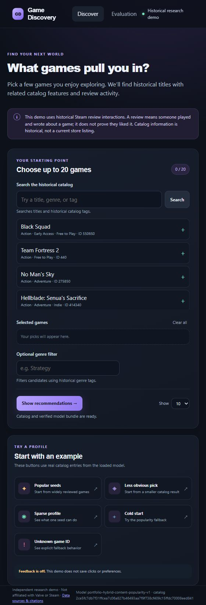
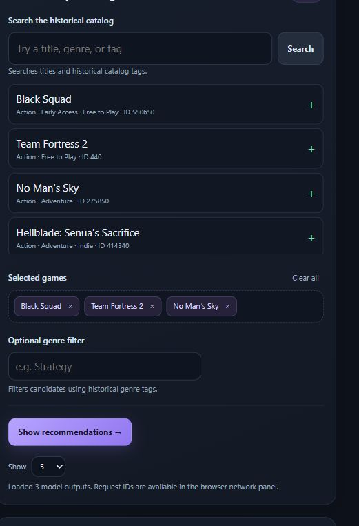
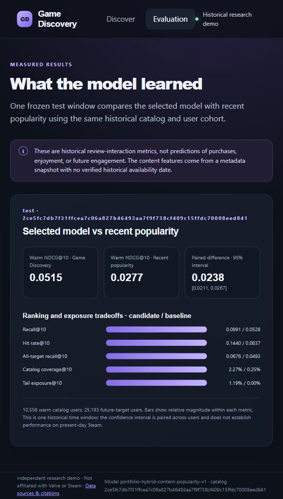
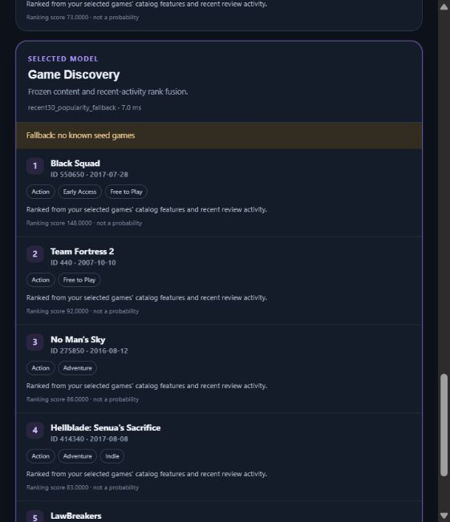
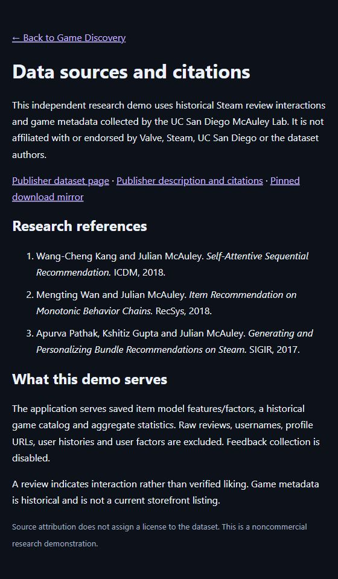

# Game Discovery: reproduce the working POC

This walkthrough uses the live [Render application](https://game-discovery-ml.onrender.com). Inputs are synthetic visitor profiles built from real historical catalog entries. It calls the deployed model without training or retuning it. Evidence is dated **2026-10-25 in Asia/Calcutta**; [live-api.json](evidence/live-api.json) stores the UTC capture timestamp.

## Start the application

1. Open the live app. Render Free may take about a minute to wake after inactivity.
2. Wait for **Catalog and verified model bundle are ready** under the controls.
3. Confirm footer model version `portfolio-hybrid-content-popularity-v1` and **Feedback is off**.
4. Explore the picker and examples. Narrow screens stack these controls; wider screens show them alongside one another.

<details>
<summary>Full Discover screen</summary>



</details>

Open [`/readyz`](https://game-discovery-ml.onrender.com/readyz) for an independent readiness check. The capture reports `status: ready`, `als_comparison_available: true`, and catalog/split identity `2ce5fc7db7f31ffcea7c06a827b46493aa7f9f738cf409c15ffdc70008eed841`.

## Reproduce the captured profile

1. Leave **Optional genre filter** empty.
2. Set **Show** to **5**.
3. Click **Popular seeds**. It selects Black Squad (`550650`), Team Fortress 2 (`440`), and No Man's Sky (`275850`) and runs the comparisons automatically.
4. Confirm **3 / 20** selected seeds and **Loaded 3 model outputs**.



For a manual profile, search for `Portal`, click **Search**, and add a returned title with **+**. Remove seeds with **×** or **Clear all**. Click **Show recommendations** after editing a manual profile. Search uses historical titles and tags rather than current storefront listings.

## Inspect each ranking

The captured popular profile produced these top five results:

| Rank | Recent popularity | ALS reference | Selected model |
|---|---|---|---|
| 1 | Hellblade: Senua's Sacrifice | Robocraft | Unturned |
| 2 | LawBreakers | Brothers - A Tale of Two Sons | Paladins® |
| 3 | Citadel: Forged with Fire | Undertale | Gigantic |
| 4 | ARK: Survival Evolved | Garry's Mod | Dirty Bomb® |
| 5 | Dark and Light | Batman™: Arkham Origins | H1Z1 |

Selected seeds do not reappear in these outputs. Cards include item IDs, available historical metadata, explanations, and ranking scores. Score scales differ; they are not probabilities or directly comparable confidence values. Shared-genre explanations describe catalog features rather than proof of enjoyment.

| Model | Serving mode | Actual output |
|---|---|---|
| Recent popularity | `recent30_popularity` | [Screenshot](assets/screenshots/03-recent-popularity.jpg) |
| ALS reference | `implicit_als_validation_reference` | [Screenshot](assets/screenshots/04-als-reference.jpg) |
| Selected model | `recent30_content_rank_fusion` | [Screenshot](assets/screenshots/05-selected-model.jpg) |

ALS was trained at the earlier validation cutoff. The interface illustrates different signals; it does not establish a winner among those three serving artifacts under a shared final-test protocol. The controlled final-test comparison is selected fusion versus recent popularity in [EVALUATION.md](../EVALUATION.md).

## Read the evaluation

Click **Evaluation**. It reads a saved aggregate from `/v1/model-info`; metrics are not hard-coded into the frontend and no new test evaluation runs.

| Display | Selected model | Recent popularity |
|---|---:|---:|
| Warm NDCG@10 | 0.0515 | 0.0277 |
| Warm Recall@10 | 0.0991 | 0.0528 |
| Warm hit rate@10 | 0.1440 | 0.0837 |
| All-target recall@10 | 0.0676 | 0.0493 |
| Catalog coverage@10 | 2.27% | 0.25% |
| Tail exposure@10 | 1.19% | 0.00% |

The paired NDCG difference displays as **0.0238**, interval **[0.0211, 0.0267]**, over **10,556 warm users**. The **25,193 future-target users** include users outside that warm cohort. These measure historical review activity in one held-out window.



## Try the boundary cases

Return to **Discover**. The [API capture](evidence/live-api.json) records the popular, cold, unknown, genre-filter, and empty-result cases.

| Action | Expected selected-model behavior |
|---|---|
| **Sparse profile** | Uses one actual catalog seed; behavior depends on its usable features. |
| **Less obvious pick** | Uses two entries from the tail-sorted catalog. |
| **Cold start** | `recent30_popularity_fallback`, reason `no_known_seed_games`. |
| **Unknown game ID** | Same explicit fallback; API reports `unknown_seed_count: 1`. |
| Set genre to `Strategy` and request again | Candidates carry that historical genre; the capture uses the popular three-seed profile. |
| Set genre to `__poc_no_such_genre__` | Zero results and `no_candidates_match_genres`; no invented matches. |

ALS has its own catalog and fallback behavior; cold or unknown profiles may not yield a distinct ALS column. The popular profile above is the three-column comparison.



## Inspect the same behavior through the API

The [interactive API documentation](https://game-discovery-ml.onrender.com/docs) lists schemas. This PowerShell example reproduces the selected profile without an API key:

```powershell
$baseUrl = 'https://game-discovery-ml.onrender.com'
$body = @{
    seed_item_ids = @('550650', '440', '275850')
    exclude_item_ids = @()
    genres = @()
    k = 5
    model = 'champion'
} | ConvertTo-Json

$result = Invoke-RestMethod -Method Post -Uri "$baseUrl/v1/recommendations" -ContentType 'application/json' -Body $body
$result | Select-Object model_version, mode, fallback_reason, returned_count
$result.recommendations | Select-Object item_id, title, ranking_score, explanation
```

Expected mode: `recent30_content_rank_fusion`; count: `5`; first item: Unturned (`304930`). Set `model` to `recent_popularity` or `als` for the references. Set `seed_item_ids` to an empty array for cold start. Request IDs and timings vary; captured outputs apply to the recorded artifact version.

Useful read-only endpoints:

- [`/readyz`](https://game-discovery-ml.onrender.com/readyz): readiness and artifact identity.
- [`/v1/catalog?q=Portal&limit=5`](https://game-discovery-ml.onrender.com/v1/catalog?q=Portal&limit=5): historical search.
- [`/v1/model-info`](https://game-discovery-ml.onrender.com/v1/model-info): method, limitations, feedback state, and saved evaluation.

[live-api.json](evidence/live-api.json) preserves **10 successful public API responses**, including all three popular-profile modes, cold start, unknown seeds, genre filtering, and an empty result. They contain no real visitor identity or history. This is a dated functional record, not a capacity benchmark.

## Check provenance and deployment evidence

Open **Data sources & citations** in the footer. It identifies the publisher and pinned mirror, lists research references, and states which artifacts the demo serves.

<details>
<summary>Source-attribution page</summary>



</details>

The [release record](../deploy/render/release.json) preserves the pinned image, source commit, model/catalog identities, and earlier HTTPS checks. Initial deployment, replacement, and rollback each passed 45 checks. Recovery used the same image/model and demonstrates deployment-revision recovery. Local memory checks and cloud checks have different scopes; cloud memory telemetry and serving capacity were not measured.

Screenshots establish displayed behavior; the API record establishes observed responses. The [evaluation](../EVALUATION.md), [frozen selection](../MODEL_SELECTION.md), and source document the offline experiment, including its historical-data and generalization limits.
